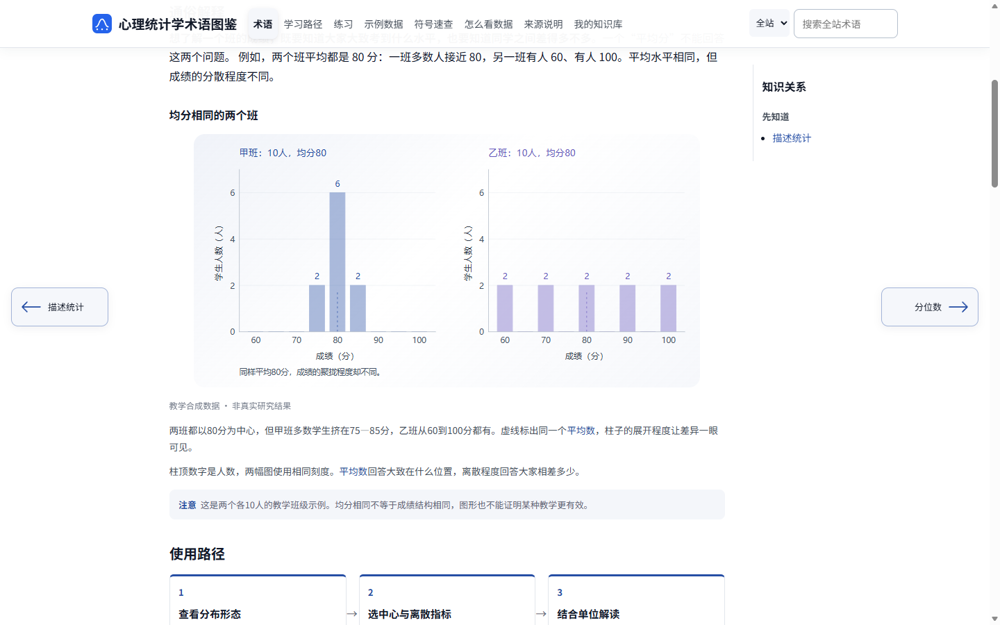
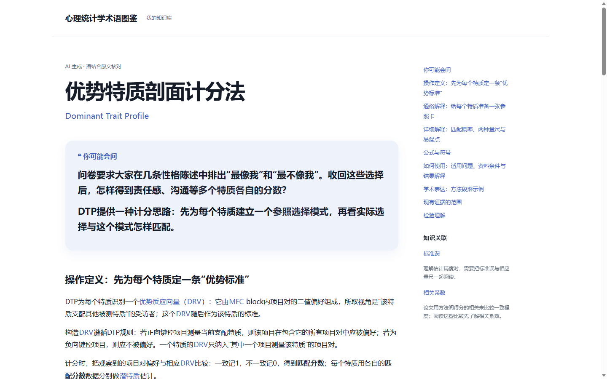

**完整产品设计与迭代报告：[阅读 PDF](docs/reports/psychstats-product-design-and-iteration.pdf) · [下载 Word](docs/reports/psychstats-product-design-and-iteration.docx)**

# 心理统计学术语图鉴 · PsychStats Platform

从一个陌生术语出发，理解它的含义与用途，再把新概念连接进自己的知识框架。

**[进入正式站：开始学习](https://cdst.site/psy-stats/)**　|　**[进入测试站：体验自定义术语与知识画布](https://cdst.site/psy-stats-test/)**

| 你想做什么？ | 从这里开始 |
| --- | --- |
| **学习和使用网站** | 打开正式站阅读已有科普；在测试站体验自定义术语与知识画布 |
| **单独使用术语 Skill** | [查看 Skill](term_explainer/skills/explain-research-term/SKILL.md) · [下载完整包](downloads/explain-research-term.zip) · [使用说明](docs/SKILL_USAGE.md) |
| **研究或修改实现** | [源码导航](#源码与运行) · [本地运行说明](docs/RUNNING.md) |

## 为谁解决什么问题？

面向具备基础心理学认知的本科生、研究生及科研人员。学习时，知道一个术语名称之后，往往还需要理解前置概念、找到具体例子、看懂图表，并判断它能用于什么问题。

本项目把现实问题、定义、图解、使用方法与理解检验放进同一条学习链，再通过个人知识库和知识关系支持持续积累。

## 正式站与测试站

| 功能与用途 | 正式站 | 测试站 |
| --- | --- | --- |
| 入口 | [cdst.site/psy-stats/](https://cdst.site/psy-stats/) | [cdst.site/psy-stats-test/](https://cdst.site/psy-stats-test/) |
| 常态学习 | 术语科普、学习路径、练习、示例数据、符号速查和结果阅读 | 提供常态学习内容 |
| 自定义术语科普 | — | 提供，生成入口需要内测邀请 |
| 个人知识库与画布 | — | 保存读本与资料，浏览和组织知识框架 |
| 运行时模型调用 | 全部为无模型功能 | 科普生成及模型辅助整理环节使用模型；常态阅读和手动整理无需生成调用 |

想查阅和复习已有知识，进入正式站；想尝试新术语学习与个人知识组织，进入测试站。测试站新功能持续迭代。

## 从学习到积累

### 看懂一个已有概念

在正式站按主题浏览或直接搜索。术语页面从“你可能会问”的现实需求切入，结合操作定义、生活例子、图示、详细解释、必要公式、R 教学、理解检验和相关术语，帮助你逐步理解和使用知识。

例如，面对“均分相同的两个班，成绩分布为什么不同”，图解把集中与分散放到同一刻度下比较，再由正文说明它与统计概念的联系。



### 为新术语建立学习读本

在[测试站生成入口](https://cdst.site/psy-stats-test/library/index.html#view=generate)输入术语，并按需提供文献。流程先核对所指概念，再依据无文献、单篇或多篇材料组织阅读与证据，生成解释、图示、理解检查和知识关联。

读本中的必要辅助概念可点击查看简释，也可沿关联继续阅读。完成后先预览，再确认保存到本机。生成目前需要管理员提供的内测邀请。



以上两张界面图摘自完整报告，展示术语教学和读本的产品形态。

### 保存资料，组织自己的知识框架

个人知识库支持归档原件与读本、管理文献、更新内容，以及备份和导出。完整备份用于恢复资料与关系，Markdown 用于便携阅读。

进入[测试站知识画布](https://cdst.site/psy-stats-test/library/index.html#view=network)，浏览官方主题网络，或建立个人框架。选中术语后查看局部关系与阅读侧栏，按需要调整布局、成员和关系，并保留人工编辑。


个人资料保存在当前浏览器，请定期导出备份；生成时按页面确认的范围发送材料。

## 源码与运行

| 模块 | 实现内容 | 入口 |
| --- | --- | --- |
| 教材 OCR 与检索 | 文本提取、OCR、页码定位、分块与检索 | [ocr/skill/](ocr/skill/) · [rag/](rag/) |
| 常态科普网站 | 结构化内容、静态构建和学习交互 | [site/](site/) |
| 自定义术语 Skill | 教学规则、来源要求和输出合同 | [Skill 目录](term_explainer/skills/explain-research-term/) |
| 术语生成服务 | 文献处理、内容编排、绘图和任务交付 | [term_explainer/](term_explainer/) · [tools/](tools/) |
| 知识库与框架 | 本机归档、导入导出、画布和关系组织 | [画布前端](site/assets/library/) · [框架后台](term_explainer/frameworks_v2.py) |

本地构建常态网站需要 Python 3.11 或更高版本，以及能运行 `.mjs` 的 Node.js。在仓库根目录执行：

```powershell
python site/build.py --mode public
python -m http.server 8000 --directory site/dist
```

打开 `http://localhost:8000`。知识库组装与生成服务见[运行说明](docs/RUNNING.md)；教材材料和路径配置见[材料准备](docs/DATA_PREPARATION.md)与[路径说明](docs/PORTABILITY.md)。原件、OCR 全文、私人资料、模型权重和真实密钥由使用者在仓库外管理。

## 项目说明与反馈

产品设计、功能取舍和完整迭代过程见页首报告。正式站与测试站按上表提供功能；源码和部署分别维护。

欢迎在 [Issues](https://github.com/GoYAY/psychstats-platform/issues) 中写明所在站点、操作步骤及遇到的问题，提交前请移除个人材料和凭证。第三方许可见 [THIRD_PARTY_NOTICES.md](THIRD_PARTY_NOTICES.md)。
