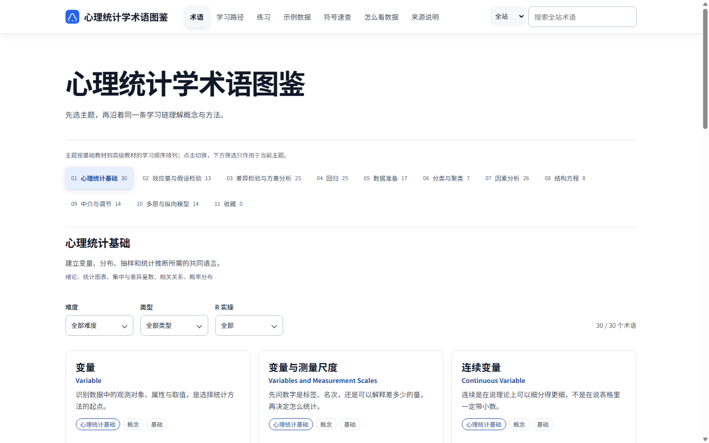
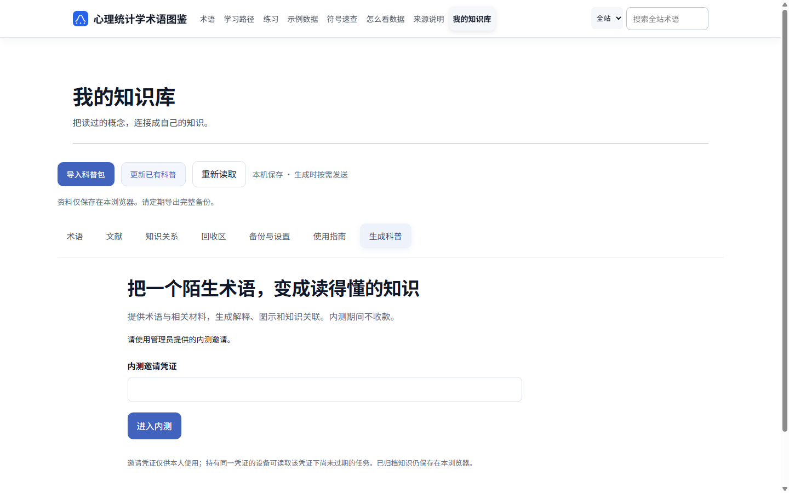
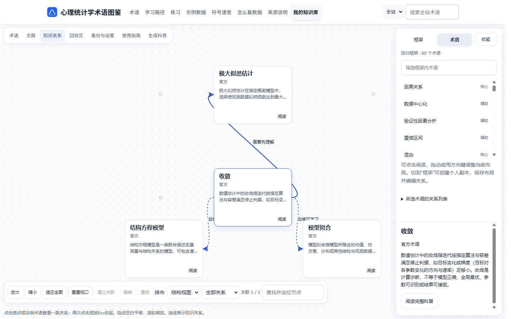

# 心理统计学术语图鉴 · PsychStats Platform

阅读心理统计科普，理解概念与方法；在测试站生成自定义术语解释，通过知识画布组织自己的知识框架。

**[进入正式站：开始学习](https://cdst.site/psy-stats/)**　|　**[进入测试站：体验新功能](https://cdst.site/psy-stats-test/)**

| 你想做什么？ | 从这里开始 |
| --- | --- |
| **学习和使用网站** | [正式站](https://cdst.site/psy-stats/)提供无模型的日常学习功能；[测试站](https://cdst.site/psy-stats-test/)增加自定义术语和知识画布 |
| **单独使用术语 Skill** | [查看 Skill](term_explainer/skills/explain-research-term/SKILL.md) · [下载完整 Skill 包](downloads/explain-research-term.zip) · [使用说明](docs/SKILL_USAGE.md) |
| **研究或修改实现** | [查看源码导航](#源码与技术实现) · [本地运行说明](docs/RUNNING.md) · [检查记录](docs/VERIFICATION.md) |

日常使用直接打开网站网址。下面展示它能帮助你完成的学习任务。

## 从一个概念开始，逐步建立知识框架

### 1. 想看懂一个心理统计概念

学习时，你可能认识“相关系数”这个词，却还想知道它回答什么问题、公式里的符号是什么意思、软件算出的结果该怎么解释。

进入**正式站**，按主题浏览术语，也可以直接搜索。结合解释、图示、公式、R 实操与测验，从概念理解走到分析结果的阅读。常态功能运行时不调用生成模型。

**正式站实景：按主题浏览、筛选和查找术语。**



### 2. 想理解一个新的研究术语

遇到网站尚未收录的概念，或希望结合自己的文献学习时，进入**测试站 → 我的知识库 → 生成科普**。按页面提示提供术语及材料，使用生成流程整理解释、图示、理解检查和知识关联。

自定义术语生成目前需要管理员提供的内测邀请。入口：[打开生成科普](https://cdst.site/psy-stats-test/library/index.html#view=generate)。

**测试站实景：自定义术语科普入口，截图显示未登录的邀请验证状态。**



### 3. 想把零散知识连接起来

理解了多个术语后，你可能还想整理它们的先后关系、包含关系和应用联系。进入**测试站 → 我的知识库 → 知识关系**，浏览官方框架，或建立个人副本，组织自己的术语与关系。

画布支持节点阅读、平移缩放、布局与关系编辑；手动整理无需生成调用。模型辅助整理按需使用。

入口：[打开知识画布](https://cdst.site/psy-stats-test/library/index.html#view=network)。

**测试站实景：回归框架中所选术语的一跳知识关系。**



三张截图采集于 2026-11-05，来自在线页面。截图过程使用空白浏览器环境，没有提交生成任务。

## 正式站与测试站

| 功能与用途 | 正式站 | 测试站 |
| --- | --- | --- |
| 访问入口 | [cdst.site/psy-stats/](https://cdst.site/psy-stats/) | [cdst.site/psy-stats-test/](https://cdst.site/psy-stats-test/) |
| 常态学习 | 术语科普、图示、公式、示例、测验等无模型功能 | 提供常态学习内容 |
| 自定义术语科普 | — | 提供，生成入口需要内测邀请 |
| 知识画布与框架 | — | 提供知识关系浏览和个人框架组织 |
| 运行时模型调用 | 不调用生成模型 | 科普生成及模型辅助整理环节使用模型 |
| 适合谁 | 想直接学习、查阅和复习的人 | 想体验新功能、参与测试和反馈的人 |

个人知识库资料保存在当前浏览器，请使用备份功能保存自己的内容；生成时按页面确认的范围发送材料。

## 项目状态与反馈

- **正式站**：提供无模型的常态学习功能。
- **测试站**：自定义术语科普和知识画布持续迭代；生成使用内测邀请。
- **源码仓库**：保存项目实现、使用文档和检查记录，当前为私有仓库。
- **本次展示检查**：三个在线页面已实际打开并检查截图；此前源码归档的构建及测试结果见[验证记录](docs/VERIFICATION.md)。

遇到问题时，在 [Issues](https://github.com/GoYAY/psychstats-platform/issues) 中写明：正式站或测试站、操作步骤、预期结果、实际结果。提交截图时请移除个人材料和凭证。

## 单独使用自定义术语 Skill

这个 Skill 为 AI 提供资料核对、来源阅读、术语教学、图示规划及结构化输出规则。适合希望在支持 Skill 的 AI 工具中，围绕自己的术语和材料开展学习的人。

**[下载完整 Skill 包](downloads/explain-research-term.zip)** · [阅读入口规则](term_explainer/skills/explain-research-term/SKILL.md) · [查看使用方法](docs/SKILL_USAGE.md)

下载包包含入口及全部包内依赖。自动生成、绘图和网页交付使用的程序服务见下方源码与运行说明。

## 源码与技术实现

学习流程由五个模块支持：

| 模块 | 实现内容 | 源码入口 |
| --- | --- | --- |
| 教材 OCR 与知识检索 | 材料识别、页码映射、分块、索引与检索 | [OCR 工具](ocr/skill/) · [检索工具](rag/) |
| 常态科普网站 | 内容组织、静态页面构建、图示与学习交互 | [网站源码](site/) |
| 自定义术语 Skill | 教学规则、来源要求和输出合同 | [Skill 目录](term_explainer/skills/explain-research-term/) |
| 自定义术语生成 | 阅读、编排、绘图、任务管理与交付 | [生成后台](term_explainer/) · [服务与工具](tools/) |
| 知识画布与框架 | 节点、关系、框架、归档与导入导出 | [画布前端](site/assets/library/) · [框架后台](term_explainer/frameworks_v2.py) |

### 本地运行常态网站

准备 Python 3.11 或更高版本，以及能运行 `.mjs` 的 Node.js。在仓库根目录执行：

```powershell
python site/build.py --mode public --check
python site/build.py --mode public
python -m http.server 8000 --directory site/dist
```

打开 `http://localhost:8000`。构建使用仓库自带 KaTeX。知识库前端组装、生成服务和部署配置见[模块与运行说明](docs/RUNNING.md)。

### 材料与依赖

本仓库保留源码、站点内容、必要资源、合成教学数据、测试和第三方许可。教材检索需要使用者按[材料准备说明](docs/DATA_PREPARATION.md)导入自己的材料。

教材 PDF、OCR 全文、课程页截图、课程 OCR 清单、向量索引、模型权重、真实密钥、用户原件及任务数据库未纳入。构建所需图表指纹清单仅保留校验字段。

### 目录导航

```text
site/             网站源码、内容和画布前端
term_explainer/   术语 Skill、生成与框架后台
ocr/skill/        扫描材料 OCR 工具
rag/              索引与检索工具
examples/         合成教学数据及分析脚本
tools/            构建、服务、打包与检查工具
deploy/           配置示例、服务模板与第三方许可
tests/            模块测试
docs/             使用说明、实景截图与验证记录
downloads/        可单独下载的术语 Skill 包
```

### 许可与版本

第三方许可见 [THIRD_PARTY_NOTICES.md](THIRD_PARTY_NOTICES.md)。项目开源许可证及公开范围待另行确定。源码归档与在线部署分别记录，部署前按实际版本核对。
